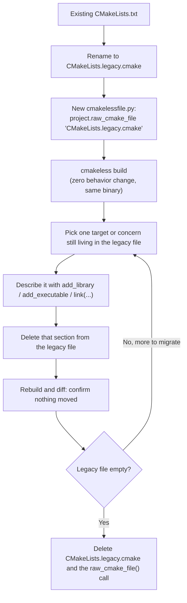

# Migration Guide: From Raw CMake

You do not have to rewrite a working `CMakeLists.txt` in one sitting to start using CMakeless. This guide covers the incremental path, a mapping table from common raw-CMake idioms to their CMakeless equivalent, and what to do about the parts that do not have one yet.

## The fast path: let CMakeless convert it

```console
$ cmakeless import --check
[cmakeless] wrote ./cmakelessfile.py (14 targets, 6 TODO(import))
[cmakeless] check: 0 difference(s)
```

Review every `# TODO(import)` line, then build. If you would rather migrate by
hand, one concern at a time, the bridge below gets you there with zero
behavior change at every step.

## The bridge: keep your CMakeLists.txt, add cmakelessfile.py alongside

Start by including your existing file verbatim from a new `cmakelessfile.py`, using the project-level escape hatch:

```python
from cmakeless import Project

project = Project("legacy", version="1.0.0", cpp_std=17)
project.raw_cmake_file("CMakeLists.legacy.cmake")  # your old file, renamed and untouched
project.build()
```

This builds exactly what you had, through CMakeless's pipeline, with zero behavior change. From here, migrate one target or one concern at a time: pick a library, describe it with `add_library(...)`/`link(...)` instead of the equivalent raw commands, delete that section from the legacy file, and rebuild to confirm nothing moved. Repeat until the raw file is empty, then delete it.



Each loop through the diagram is deliberately small and independently verifiable: a migration that stalls halfway still leaves you with a project that builds, because the legacy file and the CMakeless description cooperate rather than compete.

## Idiom mapping

| Raw CMake | CMakeless |
| --- | --- |
| `add_executable(app src/main.cpp)` | `project.add_executable("app", sources=["src/main.cpp"])` |
| `add_library(engine STATIC ...)` | `project.add_library("engine", sources=[...], kind="static")` |
| `target_link_libraries(app PRIVATE engine)` | `app.link(engine)` (private by default) |
| `target_link_libraries(engine PUBLIC math)` | `engine.link(math, public=True)` |
| `target_include_directories(engine PUBLIC include/)` | `public_headers="include/"` on `add_library(...)` |
| `target_include_directories(engine PRIVATE src/internal)` | `engine.include_dirs("src/internal")` |
| `target_compile_definitions(app PRIVATE FOO=1)` | `app.define("FOO", 1)` |
| `option(MYLIB_BUILD_GUI "..." ON)` | `project.option("MYLIB_BUILD_GUI", default=True, help="...")` |
| `find_package(fmt REQUIRED)` | `app.depends("fmt/10.2.1")` (also handles the FetchContent fallback) |
| `add_subdirectory(tools/packer)` | `project.add_subproject("tools/packer")` (its own `cmakelessfile.py`) |
| `enable_testing()` + `add_test(...)` | `project.add_test("engine_tests", sources=[...])` |
| `install(TARGETS app ...)` | `project.install(app)` |
| `include(CheckCXXCompilerFlag)` | `project.include_module("CheckCXXCompilerFlag")` |
| A hand-written toolchain file | `Toolchain.from_file("cmake/rpi4.toolchain.cmake")`, or the curated gallery (`Toolchain.arm_none_eabi()`, `.ios()`, ...) |
| `find_package(Threads)` + `Threads::Threads` | `app.link(System.threads())` |
| `target_link_libraries(app PRIVATE ws2_32)` | `app.link(System.library("ws2_32"))` |
| `set_target_properties(lib PROPERTIES VERSION 2.3.1 SOVERSION 2)` | `add_library(..., version="2.3.1", soversion="2")` |
| `set(CMAKE_CXX_VISIBILITY_PRESET hidden)` | `lib.visibility = "hidden"` |
| `add_custom_command(TARGET fw POST_BUILD ...)` | `fw.post_build("objcopy", ..., fw.file, ...)` |
| `install(TARGETS app RUNTIME_DEPENDENCY_SET ...)` | `project.install(app, runtime_dependencies=True)` |
| `set_tests_properties(t PROPERTIES TIMEOUT 30 LABELS unit)` | `add_test(..., timeout=30, labels=["unit"])` |
| `if(BUILD_GUI) add_subdirectory(gui) endif()` | `project.add_subproject("gui", when=When.option(gui))` |
| Anything else, verbatim | `target.raw_cmake("...")` / `project.raw_cmake_file("...")` |

## A worked example

Given this raw `CMakeLists.txt`:

```cmake
cmake_minimum_required(VERSION 3.25)
project(mygame CXX)
set(CMAKE_CXX_STANDARD 20)

add_library(engine STATIC src/engine/renderer.cpp src/engine/audio.cpp)
target_include_directories(engine PUBLIC include)

add_executable(mygame src/main.cpp)
target_link_libraries(mygame PRIVATE engine)
```

The equivalent `cmakelessfile.py`:

```python
from cmakeless import Project

project = Project("mygame", version="1.0.0", cpp_std=20)

engine = project.add_library(
    "engine",
    sources=["src/engine/renderer.cpp", "src/engine/audio.cpp"],
    public_headers="include",
)

app = project.add_executable("mygame", sources=["src/main.cpp"])
app.link(engine)

project.build()
```

Notice what disappeared: `cmake_minimum_required`, the `project()` boilerplate, and the `PRIVATE` keyword you had to already know to write. Nothing about the generated CMake changes in a way that would surprise a CMake user reading it afterward; that generated file is the actual bridge back to a raw-CMake mental model if you ever need one.

## What does not have a direct equivalent yet

- **Fully automatic conversion of everything.** `cmakeless import` converts targets, sources, include directories, definitions, flags, and the link graph by reading the File API codemodel of your configured project, and `cmakeless import --check` proves the result builds the same targets from the same sources. It cannot see intent the codemodel does not record (which include directories are public, which link items came from `find_package()`, `add_test()` registrations), so it marks those lines `# TODO(import)` for you to finish by hand with the table above.
- **Directory-scoped variables and `include_directories()`.** CMakeless's emitter never generates these on purpose (see [ARCHITECTURE](ARCHITECTURE.md#what-the-emitter-must-guarantee)); a raw file relying on directory-level state needs its target-centric equivalent written by hand, same as any modern-CMake migration.
- **`import std`.** Building, installing, and exporting C++20 module interfaces is fully modelled, but `import std` is still behind CMake's experimental gate, so CMakeless does not emit it yet.
- **Bespoke `.cmake` modules with heavy macro logic.** `project.include(...)` reflects what a file defines (functions, variables, targets) and lets you call into it, but very unusual control flow inside the file itself still lives in the file, not in Python.

When in doubt, `raw_cmake()`/`raw_cmake_file()` are not a failure state. They are the permanent, explicit escape hatch for the parts CMakeless does not model yet; using them is how the project finds out what to build next (see [CONTRIBUTING](https://github.com/bbalouki/cmakeless/blob/main/CONTRIBUTING.md)).
